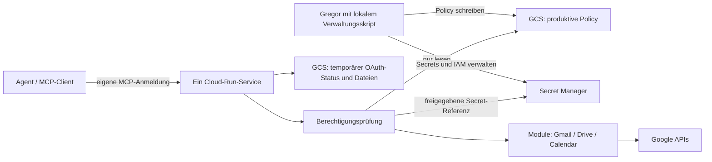

# Google Utils MCP — V1

Stand: 2026-10-24. Status: Scoping. Ergebnis dieses Projekteintrags ist ein
Implementierungsentwurf; es wurden noch keine Cloud-Ressourcen angelegt,
Konten verbunden oder Berechtigungen geändert.

## Ziel und Umfang

Ein eigener HTTP-MCP-Server macht Google-Workspace-Funktionen für lokale und
cloudbasierte Agenten nutzbar. Python-Module kapseln die offiziellen Clients;
eine zentrale Prüfung entscheidet vor jedem Aufruf, welcher authentifizierte
Aufrufer in welchem Kontext mit welchem Google-Konto welche Aktion ausführen darf.

Gmail und Drive sind Pflichtumfang, einschließlich Anhänge herunterladen,
Dateien an Entwürfe anhängen, Antworten im richtigen Thread und bestehende
Entwürfe bearbeiten. Calendar folgt demselben Modul- und Berechtigungsmuster.
Der vollständige aktuelle API-Methodenkatalog liegt separat vor:
[Methodenkatalog](20261024_API_Methodenkatalog.md).

V1 besteht aus **einem Cloud-Run-Service**. Dessen Container enthält den
MCP-Endpunkt, den Google-OAuth-Callback und die Dateiübertragung. Es gibt keinen
zweiten Verwaltungsservice. Rechte und Cloud-Ressourcen verwaltet Gregor mit
lokalen Skripten unter seiner eigenen Google-Identität. Diese Skripte liegen im
künftigen Code-Repo, werden aber nicht ins Laufzeit-Image aufgenommen.

Anleitungen für diese Verwaltung:
[Agentenleitfaden](20261024_Agentenleitfaden_Verwaltung.md).

Nicht Teil von V1: Standortbewertung, adaptive Neuanmeldung nach Zeit/Volumen,
ein Verwaltungs-Webinterface und automatisches Erweitern von Rechten. Begrenzte
Dateigrößen, Laufzeiten und Aufrufmengen gehören trotzdem zur normalen Laufzeit.

## Architektur



Die GCS-Policy ist eine Anwendungsrichtlinie. Google IAM schützt diese Datei und
die Secrets; IAM interpretiert nicht die darin aufgelisteten Gmail-/Drive-Aktionen.
Die Anwendung setzt diese feineren Regeln selbst durch.

Eine separate GCP-Projektgrenze ist sinnvoll, aber kein Muss. Auch in einem
eigenen Projekt werden Rechte eng vergeben. Bei einem vorhandenen Projekt
werden Secrets einzeln und Storage-Rechte auf die benötigten Buckets/Objekte
beschränkt. Kein Owner, Editor oder Secret Manager Admin für die Laufzeit.
[Secret-IAM](https://docs.cloud.google.com/secret-manager/docs/access-control).

## Künftiges Code-Repository

Dieses Verzeichnis in labore enthält ausschließlich die Planung. Die Umsetzung
gehört in ein eigenständiges Utility-Repo, beispielsweise `google-utils-mcp` unter
`~/Projects/agent-utilities/`; dessen Erstellung ist noch nicht erfolgt.

```text
google-utils-mcp/
├── README.md
├── AGENTS.md
├── pyproject.toml
├── uv.lock
├── src/google_utils_mcp/
│   ├── app.py                    # HTTP-Routen und Start auf PORT
│   ├── mcp_server.py             # Tool-Registrierung, gefilterte Discovery
│   ├── identity.py               # MCP-Aufrufer authentifizieren
│   ├── policy/
│   │   ├── models.py             # striktes Schema
│   │   ├── store.py              # GCS-Lesen und Generationen
│   │   ├── authorize.py          # deny-by-default, deny gewinnt
│   │   └── constraints.py        # Ressourcen- und Argumentgrenzen
│   ├── credentials/
│   │   ├── secrets.py            # ADC, erlaubte Secret-Referenzen
│   │   └── google_oauth.py       # pro Konto/Service, Access-Token-Refresh
│   ├── oauth/
│   │   ├── routes.py             # /oauth/google/start und /callback
│   │   └── transactions.py       # einmaliger, kurzlebiger OAuth-Status
│   ├── services/
│   │   ├── gmail.py
│   │   ├── drive.py
│   │   └── calendar.py
│   ├── artifacts.py              # binärer Upload/Download, opaque file_ref
│   ├── registry.py               # Tool → Methoden-ID → Validatoren
│   └── audit.py                  # ohne Nachrichteninhalte/Secretwerte
├── schemas/
│   ├── policy.schema.json
│   └── enrollment.schema.json
├── examples/
│   └── policy.example.yml        # ausschließlich künstliche Platzhalter
├── scripts/admin/                # lokal, NICHT deployen
│   ├── bootstrap.sh              # APIs, SA, Buckets, Secret-Hüllen
│   ├── policy_cli.py             # pull, validate, diff, publish, rollback
│   ├── account_cli.py            # planen, verbinden, Status, deaktivieren
│   ├── secret_cli.py             # Secret-Versionen ohne Ausgabe der Werte
│   ├── client_cli.py             # eigenen MCP-Zugang anlegen/widerrufen
│   ├── generate_api_catalog.py   # Discovery-Snapshot und Abdeckungsmatrix
│   └── verify_image.sh           # Image-Inhalt und IAM prüfen
├── infrastructure/               # Terraform ohne Secretwerte im State
├── docs/                         # Setup, Policy-Semantik, Betrieb
├── tests/                        # Policy-, Wrapper-, OAuth-, Datei-Tests
├── Dockerfile
├── .dockerignore
├── .gcloudignore
└── .gitignore
```

Offizielle Bibliotheken: `google-api-python-client`, `google-auth`,
`google-auth-oauthlib`, `google-cloud-storage`, `google-cloud-secret-manager`.
MCP über das offizielle Python-SDK und Streamable HTTP. Abhängigkeiten und
Discovery-Snapshots pinnen, neue Methoden erst nach Prüfung freischalten.

Bestehende `gmail-utils`-/`drive-utils`-Funktionen wiederverwenden, wenn sie sich
mit injizierten Credentials und vorgeschalteter Policy nutzen lassen. Fehlende
Funktionen dort ergänzen, statt dieselbe Fachlogik mehrfach zu implementieren.
Die bestehenden Pakete haben heute noch lokale Token-/Pickle-Pfade; diese
Anpassung ist Voraussetzung, keine bereits vorhandene Cloud-Funktion.

## Cloud-Ressourcen und IAM

| Ressource / Identität | Aufgabe und Grenze |
|---|---|
| Cloud Run `google-utils-mcp` | Ein Service; kann bei Bedarf mehrere Instanzen haben |
| Runtime-Service-Account | Zugewiesene Service-Identität via ADC, kein JSON-Key |
| Policy-Bucket | Produktionsdatei und administrative Verbindungsaufträge; Runtime nur lesend |
| Temporärer Bucket | OAuth-Transaktionen und Datei-Artefakte; Runtime darf diese schreiben/löschen |
| Secret Manager | Client-Secret, Refresh-Tokens und MCP-Zugangsprüfwerte |
| Gregors Verwaltungsidentität | Policy, IAM, Secrets und Deployment über lokale Skripte |

Den Policy-Bucket von einem Bucket für temporäre Dateien trennen. Die Runtime
erhält dort höchstens `roles/storage.objectViewer`; der Verwaltungspfad darf
schreiben. Auf benötigten Secrets `roles/secretmanager.secretAccessor` vergeben.
Wenn der OAuth-Callback neue Refresh-Tokens dauerhaft ablegt, zusätzlich
`roles/secretmanager.secretVersionAdder` ausschließlich auf vorher angelegten
Token-Secrets vergeben. Client-Secret und MCP-Zugangsprüfwerte bleiben für die
Runtime nur lesbar. Keine Secret-Erstellung oder IAM-Änderung durch die Runtime.
[Storage-IAM](https://docs.cloud.google.com/storage/docs/access-control/iam-roles).

Deploy-Rechte und Service-Account-Impersonation sind ebenfalls Verwaltungsrechte.
Ein Agent mit diesen Rechten könnte Code mit Runtime-Credentials deployen und
damit die Anwendungsprüfung umgehen. Die Agenten-Laufzeit erhält sie nicht.
Ein kompromittierter Serverprozess könnte auf alle ihm per IAM zugänglichen
Tokens zugreifen; ein gemeinsamer Service ist keine harte Isolation zwischen
seinen Konten. Für V1 ist das eine bewusst dokumentierte Vertrauensgrenze.

## Zwei verschiedene Anmeldungen

1. **Agent → eigener MCP-Server:** authentifiziert den Aufrufer; daraus folgt
   seine Principal-ID. Ein frei übergebenes `user`, `email` oder `account`
   authentifiziert niemanden.
2. **Server → Google:** verwendet pro verbundenem Google-Konto den passenden
   OAuth-Refresh-Token, um Gmail/Drive/Calendar anzusprechen.

V1 verwendet einen zufälligen, widerrufbaren Bearer-Zugang pro MCP-Client, mit
mindestens 256 Bit Zufall. Der Server speichert nur dessen SHA-256-Prüfwert in
einem separaten Secret und vergleicht ihn in konstanter Zeit. Die Policy ordnet
die Secret-Referenz einer Principal-ID zu. Der Client speichert den eigentlichen
Zugang in seinem Credential Store; bei Anthropic-hosted Zugriff ist ein
hostgebundenes Network Secret eine Option. Nicht im Chat oder Repo hinterlegen.
Die konkrete Header-Konfiguration ist mit dem Zielclient praktisch zu prüfen.

Das ist ein einfacher vorkonfigurierter Zugang, kein eigener OAuth-
Authorization-Server. Für spätere automatische OAuth-Anmeldung von MCP-Clients
einen vorhandenen kompatiblen Anbieter integrieren, statt das Protokoll selbst
nachzubauen. Google-API-Tokens niemals als beliebige MCP-Login-Tokens akzeptieren.
[MCP-Autorisierung](https://modelcontextprotocol.io/specification/latest/basic/authorization).

## Produktionsdatei in Google Cloud Storage

Vorgeschlagener Pfad: `gs://POLICY_BUCKET/policies/google-utils-mcp.yml`.
Bucket und Objektpfad kommen aus der Deployment-Konfiguration, nicht aus
Werkzeugargumenten. YAML dient nur als lesbares Datenformat; zur Laufzeit wird
es strikt validiert. Keine Secrets in dieser Datei, nur Secret-Referenzen.
Produktive Konto-/Rechtezuordnungen bleiben außerhalb des Code-Repos.

Beispiel mit künstlichen Konten; es erteilt keine Rechte für tatsächliche
labore-Konten. `contexts.yml` wird dadurch weder geändert noch ersetzt.

```yaml
schema_version: 1
policy_revision: "20261024-001"
default_effect: deny

owners:
  gregor:
    display_name: Gregor

principals:
  gregor-cloud:
    owner: gregor
    enabled: true
    credential_digest_secret_ref: projects/PROJECT/secrets/mcp-client-gregor-cloud/versions/latest
    allowed_contexts: [private]

oauth_clients:
  workspace:
    client_id: CLIENT_ID.apps.googleusercontent.com
    client_secret_ref: projects/PROJECT/secrets/oauth-workspace-client-secret/versions/latest

accounts:
  mailbox-main:
    owner: gregor
    enabled: true
    expected_email: mailbox@example.net
    google_subject: GOOGLE_SUB_MAILBOX
    services:
      gmail:
        oauth_client: workspace
        refresh_token_secret_ref: projects/PROJECT/secrets/gmail-mailbox-main-refresh/versions/latest
        oauth_scopes:
          - https://www.googleapis.com/auth/gmail.modify
  drive-agent:
    owner: gregor
    enabled: true
    expected_email: drive-agent@example.net
    google_subject: GOOGLE_SUB_DRIVE_AGENT
    services:
      drive:
        oauth_client: workspace
        refresh_token_secret_ref: projects/PROJECT/secrets/drive-agent-refresh/versions/latest
        oauth_scopes:
          - https://www.googleapis.com/auth/drive

contexts:
  private:
    grants:
      gregor-cloud:
        mailbox-main:
          gmail:
            allow:
              - gmail.users.getProfile
              - gmail.users.messages.list
              - gmail.users.messages.get
              - gmail.users.messages.attachments.get
              - gmail.users.threads.get
              - gmail.users.labels.list
              - gmail.users.labels.create
              - gmail.users.messages.modify
              - gmail.users.drafts.create
              - gmail.users.drafts.get
              - gmail.users.drafts.list
              - gmail.users.drafts.update
            deny:
              - gmail.users.messages.send
              - gmail.users.drafts.send
              - gmail.users.messages.delete
              - gmail.users.messages.batchDelete
              - gmail.users.messages.trash
              - gmail.users.threads.delete
              - gmail.users.threads.trash
              - gmail.users.drafts.delete
            constraints:
              forbidden_added_label_ids: [TRASH, SPAM]
        drive-agent:
          drive:
            allow:
              - drive.files.list
              - drive.files.get
              - drive.files.export
              - drive.files.create
              - drive.files.update
            deny:
              - drive.files.delete
              - drive.files.emptyTrash
              - drive.permissions.create
              - drive.permissions.update
              - drive.permissions.delete
            constraints:
              allowed_root_ids: [DRIVE_ROOT_ID]
              forbidden_folder_ids: [FORBIDDEN_FOLDER_ID]
              allowed_update_fields: [name, description, media]
              allow_move: false
              allow_trash: false
              allow_permission_changes: false

limits:
  max_page_size: 100
  max_attachment_bytes: 20000000
  max_message_bytes: 30000000
  max_upload_bytes: 20000000
  max_download_bytes: 100000000
  artifact_ttl_seconds: 1800
```

### Verbindliche Semantik des Schemas

- `owners` gruppiert Konten; `principals` bezeichnet authentifizierte Clients.
  Mehrere Clients können einem Owner gehören und unterschiedliche Rechte haben.
- Konto-Aliasse werden serverseitig auf Email, Google-Subject, Client und Secret
  aufgelöst. Mehrere Konten je Owner und Service sind ausdrücklich vorgesehen.
- Effektive Rechte ergeben sich aus Principal + Kontext + Konto + Methoden-ID
  + Argument-/Ressourcenprüfung + tatsächlichen OAuth-Berechtigungen.
  Ohne exakte Freigabe gilt Ablehnung; `deny` gewinnt. V1 kennt keine Wildcards
  oder Vererbung für Freigaben und kombiniert nicht mehrere Kontexte.
- Ein fremder Owner, ein deaktivierter Eintrag, unbekannte Methode oder ungültige
  Referenz wird abgelehnt. Beim Beispiel oben existieren keine Calendar-Rechte.
- `oauth_scopes` dokumentiert den autorisierten Umfang; ein Eintrag allein
  beschafft keine Google-Berechtigung. Zu breite reale Tokens werden als
  Abweichung gemeldet. Eine geringere Policy begrenzt nur diesen Server.
- Beim Verbinden Email und unveränderliches Google-Subject über Google prüfen
  (`openid email` für die Identitätsprüfung zusätzlich anfordern). Aliasse oder
  `login_hint` sind kein Identitätsbeweis. Ein noch nicht verbundenes Konto bleibt
  deaktiviert; das Skript übernimmt das verifizierte Subject vor Aktivierung.
- Die Client-ID und die im Token-Secret hinterlegte Bindung müssen übereinstimmen.
  Ein Refresh-Token lässt sich nicht beliebig einem anderen OAuth-Client zuordnen.
- Secret-Projekte und -Namen zusätzlich gegen Deployment-Vorgaben prüfen.
  Ein manipulierter Secret-Verweis verschafft keine IAM-Rechte.
- YAML mit Safe Loader, ohne doppelte Keys, eigene Tags oder Alias-/Merge-Tricks
  lesen. Unbekannte Felder und ungültige Operationen sind Schemafehler.
- Der Server darf die Policy niemals über ein MCP-Werkzeug verändern. Es gibt
  kein `allow_all`, `execute_python`, beliebiges `http_request` oder ungeprüftes
  `call_google_api` als Umgehung.

### Policy-Lesen und Änderungen

V1 prüft vor jedem Tool-Aufruf die aktuelle Objektgeneration in GCS und lädt
bei Änderung die ganze Datei neu. Den Download an diese Generation binden und
die validierte Policy atomar austauschen. Jeder Aufruf arbeitet mit genau einer
Generation. Fehlt sie, ist GCS nicht erreichbar oder die neue Datei ungültig,
wird der Aufruf abgelehnt; keine unbegrenzte Nutzung einer alten Freigabe.
Bereits gestartete Google-Aufrufe lassen sich dadurch nicht rückgängig machen.

Das lokale Skript schreibt mit `ifGenerationMatch` auf die gelesene Generation.
Bei paralleler Änderung abbrechen und neu vergleichen. Versionierung für
Nachvollziehbarkeit/Rollback aktivieren; Rollback bedeutet eine frühere,
validierte Policy bewusst als neue aktuelle Version veröffentlichen.
Die SHA/Generation wird im Audit mitgeführt.
[GCS-Preconditions](https://docs.cloud.google.com/storage/docs/request-preconditions).

## OAuth auf demselben Cloud-Run-Service

Ja: Der Callback kann auf demselben Service wie `/mcp` liegen, beispielsweise
`https://SERVICE_URL/oauth/google/callback`. Diese vollständige HTTPS-URL wird
beim Google-OAuth-Client vom Typ Web application exakt als Redirect URI
registriert. Das Aktivieren von Gmail/Drive/Calendar und das Registrieren der
OAuth-App ersetzen nicht die Zustimmung jedes verbundenen Google-Kontos.

Vorgesehene Routen:

| Route | Zweck |
|---|---|
| `POST /mcp` | MCP Streamable HTTP; weitere Transportmethoden nach SDK |
| `/oauth/google/start` | Nur mit gültigem, administrativ angelegtem Verbindungsauftrag |
| `/oauth/google/callback` | Google-Antwort prüfen, Code austauschen, Token ablegen |
| `POST /artifacts` | Authentifizierter binärer Upload |
| `GET /artifacts/{id}` | Authentifizierter Download eines eigenen Artefakts |
| `/healthz` | Minimales Liveness-Ergebnis ohne Konto-/Secretinformationen |

V1-Verbindungsablauf ohne zweites Backend:

1. Das lokale Skript legt die Secret-Hülle und einen zeitlich begrenzten
   Verbindungsauftrag im nur administrativ beschreibbaren Policy-Bucket an.
   Dieser bindet eine zufällige Intent-ID an Konto-Alias, erwartete Email,
   Service, OAuth-Client, Ziel-Secret und exakte gewünschte Scopes.
2. Das Skript öffnet den Start-Link im Browser. Der Service akzeptiert nur
   diesen gültigen Auftrag; die normalen Agenten-Credentials reichen nicht,
   um selbst neue Verbindungsaufträge zu erstellen.
3. Der Server erzeugt OAuth-`state`, OIDC-`nonce` und PKCE-Daten. Kurzlebige
   Transaktionsdaten liegen im separaten temporären Bucket, nicht nur im RAM.
4. Google-Anmeldung mit `access_type=offline`, passenden API-Scopes und
   `openid email`; `prompt=consent` gezielt für erstmalige/erneuerte Freigabe,
   nicht für jeden normalen API-Aufruf.
5. Google leitet den Browser automatisch zum Callback. State, Nonce, Ablauf,
   PKCE und Google-Identität werden geprüft. Die Transaktion wird vor dem
   Token-Austausch atomar einmalig verbraucht; bei Fehler neu starten.
6. Nur für das vorher bestimmte Token-Secret wird eine neue Version angelegt.
   Danach prüft das lokale Skript den Status und veröffentlicht gegebenenfalls
   den aktivierten Konto-Eintrag. Der Callback schreibt keine Policy.

Cloud Run kann verschiedene Requests auf verschiedene Instanzen verteilen.
Ein einzelner Service bedeutet daher nicht einen einzigen Prozess. OAuth-Status
und Artefakte müssen auch nach Neustart/Instanzwechsel funktionieren. Für OAuth-
Transaktionen GCS-Generationsbedingungen beim Anlegen und Verbrauchen verwenden;
ein Verbindungsauftrag darf nur eine aktive beziehungsweise abgeschlossene
Transaktion zulassen. Keine Session-Affinity als Sicherheitsvoraussetzung.

Der kurzlebige Access-Token bleibt im Instanzspeicher und wird durch
`google-auth` erneuert. Nicht jeden Access-Token-Refresh als neue Secret-Version
schreiben. Das dauerhafte Token-Secret enthält mindestens `refresh_token`,
`account_alias`, verifiziertes `google_subject`, `oauth_client`, autorisierte
Scopes und Verbindungszeitpunkt. Kein Passwort, kein Pickle, keine Tokenausgabe.
Falls ein Token-Austausch einen neuen Refresh-Token liefert, diesen sicher als
neue Version ablegen; fehlt einer, einen vorhandenen nicht mit leerem Wert ersetzen.
Bei `invalid_grant` Zustand `reauth_required` melden und nicht endlos wiederholen.
[Google-Web-OAuth](https://developers.google.com/identity/protocols/oauth2/web-server).

Ein normales Access-Token-Ablaufen erfordert keine menschliche Anmeldung.
Refresh-Tokens können dennoch widerrufen/ungültig werden. Bei externen OAuth-
Apps im Testing-Modus gilt für diese API-Scopes die siebentägige Laufzeit;
Produktionsstatus ist deshalb für den Dauerbetrieb relevant.
[Token-Lebenszyklus](https://developers.google.com/identity/protocols/oauth2#expiration).

Nicht geheime Laufzeitkonfiguration: `POLICY_URI`, `TEMP_BUCKET`,
`GOOGLE_CLOUD_PROJECT`, `PUBLIC_BASE_URL`, `PORT` und eine feste Liste erlaubter
Secret-Projekte beziehungsweise Namensbereiche. OAuth-Client-Secrets und
Refresh-Tokens werden über die Policy-Referenzen nachgeladen. Damit gibt es
keinen lokalen Credential-Pfad, der auf einer neuen Instanz fehlen könnte.

## Wrapper und Rechteprüfung

Tool-Namen sind lesbar, beispielsweise `gmail_drafts_update` oder
`drive_files_get`. Die Policy verwendet die kanonischen Discovery-Methoden-IDs
aus dem Katalog. Das Registry-Mapping ist explizit; Google-Client-Helfer wie
`execute()`, `get_media()`, Pagination und Batch-Transport sind keine eigenen
geschäftlichen Freigaben.

Ablauf jedes Aufrufs:

1. MCP-Client authentifizieren; Principal-ID aus dem gültigen Zugang bestimmen.
2. Eingaben typisieren; die aktuelle Policy laden/validieren.
3. Principal, Kontext, Konto, Service und exakte Methode prüfen.
4. Argumente, alle betroffenen Ressourcen und zusammengesetzte Aktionen prüfen.
5. Erst dann Konto-Credentials laden; notwendige minimale Metadatenprüfungen
   intern durchführen und die fachliche Aktion nur bei vollständiger Freigabe starten.
6. Ergebnis begrenzen; Binärdaten in Artefakte auslagern; Audit schreiben.

`tools/list` zeigt nur grundsätzlich freigegebene implementierte Werkzeuge.
Das ersetzt niemals die erneute Prüfung bei `tools/call`. Ein Kontoargument
ist nur eine Auswahl unter den zulässigen Konten. Gmail-`userId` wird serverseitig
auf `me` gesetzt; fremde Nutzer-IDs werden nicht durchgereicht.

Reine Metawerkzeuge dürfen die eigenen erreichbaren Konto-Aliasse,
effektiven Rechte, implementierten Fähigkeiten und Zustände wie
`connected`/`reauth_required` anzeigen. Sie liefern weder fremde Konten noch
Secret-Referenzen oder Werte. OAuth-Refresh ist intern; Rechte ändern und
Konten neu verbinden bleiben dem administrativen Skriptablauf vorbehalten.

### Warum die Methodenfreigabe allein nicht genügt

- `gmail.users.messages.modify` kann über `TRASH`/`SPAM` verbotene Aktionen
  auslösen. Dasselbe gilt für Threads, Bulk-Aufrufe und Filteraktionen.
- `drive.files.update` kann Dateien bearbeiten, verschieben, in den Papierkorb
  legen oder weitere Attribute ändern. Felder und Parent-Änderungen gesondert prüfen.
- Drive-Freigaben, neue Eigentümer und öffentliche Links sind eigene Aktionen;
  keine Freigabe über eine vermeintliche Metadatenänderung verstecken.
- Drive-Root-Grenzen gelten für Suche, direkte IDs, Downloads, Exporte, Kopien,
  Kommentare, Revisionen, Berechtigungen und Quell-/Zielordner. Parent-Kette
  serverseitig auflösen, Shortcuts ebenfalls prüfen, ausgeschlossene Unterordner
  über IDs erkennen. Ein `q`-Filter oder Ordnername allein ist keine Grenze.
- Listen/Changes dürfen auch keine unzulässigen Metadaten ausgeben. Breite
  Methoden ohne sicheren Ressourcenfilter bleiben für beschränkte Konten gesperrt.
- Calendar benötigt freigegebene Calendar-IDs. Gäste, `sendUpdates`, ACLs,
  Kalendertransfer und Aktionen mit Benachrichtigungen gesondert prüfen.
- Eine Bestätigung durch das Modell selbst ersetzt keine menschliche Freigabe.
  V1 erteilt zusätzliche Rechte ausschließlich über den lokalen Verwaltungspfad.

Alle Methoden werden inventarisiert. Der implementierte Umfang wird mit Status
`supported`, `unsupported` oder `requires_special_account` dokumentiert.
Erst ein fertiger Wrapper mit passenden Prüfungen darf freigeschaltet werden.
Discovery-generierte Schemas sparen Schreibarbeit; ein ungeprüfter dynamischer
Dispatcher wäre keine sichere Implementierung dieses Entwurfs.

## Anhänge, Dateien und Threads

Ein Remote-MCP-Server sieht keine lokalen Dateipfade auf der Agenten-VM.
`/tmp/rechnung.pdf` beim Agenten ist nicht dieselbe Datei wie `/tmp/...` in Cloud Run.
Daher ein expliziter Binärkanal statt Megabytes Base64 durch den Modellkontext:

- Upload: Client lädt die Datei authentifiziert nach `/artifacts`; Antwort
  enthält eine zufällige `file_ref`. Der Gmail-/Drive-Aufruf referenziert diese.
- Download: Gmail-Anhang beziehungsweise Drive-Datei wird als Artefakt mit
  `file_ref`, Dateiname, MIME-Typ, Größe und Prüfsumme bereitgestellt. Der Client
  lädt die Bytes per authentifiziertem HTTP auf seine Maschine.
- Artefakte sind an Principal/Owner und Kontext gebunden, haben kurze Laufzeit
  und werden bei jedem Zugriff geprüft. Herkunft und aktuelle Quellrechte bei
  Weiterverwendung berücksichtigen. Kein öffentlicher Bucket, kein beliebiger
  Bucket-/URL-Import und kein vom Agenten bestimmbarer Server-Dateipfad.
- Empfangene Dateinamen normalisieren; Pfadtraversal, Übergrößen und falsche
  MIME-Angaben behandeln. Ablaufzeit aktiv prüfen, nicht nur auf verzögerte
  GCS-Lifecycle-Bereinigung vertrauen.

Gmail: Anhänge über `users.messages.attachments.get` oder bereits im MIME-Teil
enthaltene Daten lesen. Entwürfe mit Python-Email/MIME aus Text/HTML und Dateien
erzeugen und über `drafts.create` / `drafts.update` ablegen. Beim Update den
vorhandenen Entwurf laden und Anhänge/Empfänger/Threading erhalten, sofern die
Änderung sie nicht ausdrücklich betrifft; konkurrierende Änderungen erkennen
und abbrechen statt still überschreiben. Gmail ersetzt den Nachrichteninhalt
beim Update und bietet hier keinen allgemeinen atomaren Compare-and-swap für
manuelle Gmail-Änderungen; verbleibendes Rennfenster dokumentieren.

Für Antworten `threadId`, `In-Reply-To`, `References` und passenden Betreff
korrekt setzen. `reply` und `reply_all` sind zusätzliche Komfort-Wrapper, keine
eigenen Gmail-REST-Methoden. Standard ist ein Antwortentwurf. Senden ist eine
separate Freigabe und bleibt für die aktuellen labore-Kontexte verboten.
[Gmail-Entwürfe](https://developers.google.com/workspace/gmail/api/guides/drafts),
[Gmail-Anhänge](https://developers.google.com/workspace/gmail/api/reference/rest/v1/users.messages.attachments/get).

Drive: Download von Binärdateien, Export von Google-Workspace-Dateien und
Upload sind unterschiedliche Clientpfade; Resumable Upload und große Dateien
entsprechend behandeln. Für neue Docs-/Sheets-/Slides-Inhalte können deren
eigene APIs nötig sein; Drive allein ist kein vollständiger Dokumenteditor.

## Build und Betrieb

- Server bindet an `0.0.0.0:$PORT`; TLS terminiert Cloud Run. Protokollversionen
  und Transportverhalten des gewählten MCP-SDK explizit testen.
- `.gcloudignore` schützt den Upload bei unterstützten gcloud-Build-/Deploy-
  Befehlen; `.dockerignore` schützt den Docker-Build-Kontext. Im Dockerfile nur
  Runtime, benötigte Schemas und installierte Runtime-Abhängigkeiten kopieren,
  niemals pauschal `COPY . .` in das finale Image.
- `scripts/`, `infrastructure/`, `tests/`, `examples/`, lokale Policies,
  `.env*`, `secrets/`, Token-Dateien und `.git/` aus dem finalen Image halten.
  Produktive Dateien außerdem über `.gitignore` schützen. Verifizierbare
  Beispiel-Policies ohne echte Zuordnungen dürfen im Code-Repo liegen.
- OAuth-Callback-Handler sind Runtime-Code und werden deployed; lokale
  Verwaltungs-/Bootstrap-Skripte werden nicht deployed.
- Keine Secretwerte in Docker-Layern, Build-Argumenten, Terraform-State oder
  Logs. Cloud-Infrastruktur kann Secret-Hüllen und IAM verwalten, Werte werden
  separat eingespielt. Keine Debug-Ausgabe von Tokens oder MIME-Nachrichten.
- Audit: Zeit, Request-ID, Principal, Kontext, Konto-Alias, Methode,
  Policy-Generation, Entscheidung, Laufzeit und Fehlerklasse. Inhalte,
  Refresh-Tokens, Client-Secrets und Authorization-Header ausschließen.
- Read-Requests begrenzt wiederholen; Senden, Upload-/Create-Aktionen und andere
  nicht idempotente Writes nicht blind nach einem Timeout wiederholen.
- Shutdown, Timeouts, Pagination, Quoten, Worker/Thread-Sicherheit der Google-
  Clients und Parallelzugriffe berücksichtigen. Keine Credentials oder
  kontoabhängigen Clients global zwischen Nutzern vertauschen.
[gcloudignore](https://docs.cloud.google.com/sdk/gcloud/reference/topic/gcloudignore),
[Cloud-Run-Vertrag](https://docs.cloud.google.com/run/docs/container-contract).

## Umsetzung und Abnahme

1. Eigenes Utility-Repo anlegen; vorhandene Utility-Schnittstellen gezielt prüfen.
2. Schema/Validator, Registry und zentrale Autorisierung implementieren.
3. Infrastruktur und lokale Verwaltungsskripte erstellen; Container-Ausschlüsse prüfen.
4. MCP-Client-Zugang, Google-OAuth-Flow und ein einzelnes Testkonto verbinden.
5. Gmail-Lesen, Anhänge und Draft-Workflow; danach Drive-Dateioperationen.
6. Übrige Methoden laut Abdeckungsmatrix und Calendar ergänzen; keine neuen
   Rechte allein deshalb vergeben, weil ein Wrapper verfügbar wird.
7. Erst nach Tests reale Konten und bestehende labore-Aufrufe migrieren.

Abnahme muss insbesondere belegen:

- Unbekannter Client, Kontextwechsel, fremdes Konto, deaktiviertes Konto und
  nicht erlaubte Methode erreichen keine fachliche Google-Aktion.
- Runtime kann Policy und IAM nicht ändern und keine fremden Secrets lesen.
- Deny-Regeln greifen auch über indirekte API-Parameter, Bulk-Aufrufe,
  Shortcuts und direkte Drive-Datei-IDs.
- Neue Policy gilt auf mehreren Instanzen; ungültige/unlesbare Policy sperrt.
- OAuth funktioniert bei Instanzwechsel, abgelaufenem State, Replay,
  falschem Google-Konto und widerrufenem Refresh-Token korrekt.
- PDF herunterladen und an einen Antwortentwurf anhängen; Entwurf verändern,
  ohne bestehende Anhänge und Thread-Zuordnung zu verlieren; niemals senden.
- Artefakt eines anderen Nutzers/Kontexts oder nach Ablauf ist nicht abrufbar.
- End-to-End aus einer echten Claude-Code-Cloud-Sitzung: MCP-Zugang sowie
  binäre HTTP-Uploads/Downloads einschließlich Netzwerkerreichbarkeit prüfen.
- Fertiges Image enthält keine Verwaltungswerkzeuge, Live-Policies oder Secrets.

Offen vor Implementierung: konkretes GCP-Projekt/Region, Repo-Name, erster
Zielclient, konkrete Konto-/Kontextzuordnungen und gewünschter Calendar-Umfang.
Diese Entscheidungen blockieren die Planung nicht; sie sind keine erteilten
Produktionsfreigaben.

## Quellen und Zusammenhang

- [API-Methodenkatalog mit aktuellen Discovery-Snapshots](20261024_API_Methodenkatalog.md).
- [Lokaler Agentenleitfaden](20261024_Agentenleitfaden_Verwaltung.md).
- Bestehende labore-Regeln: `contexts.yml`, `.agents/rules/contexts-and-accounts.md`.
- [Cloud-Run-Service-Identität ohne Schlüsseldatei](https://docs.cloud.google.com/run/docs/securing/service-identity).
- [Google-OAuth-Grundlagen](https://developers.google.com/identity/protocols/oauth2).
- [IAP-Reauthentifizierung für eine spätere Browserverwaltung](https://docs.cloud.google.com/iap/docs/configuring-reauth).
